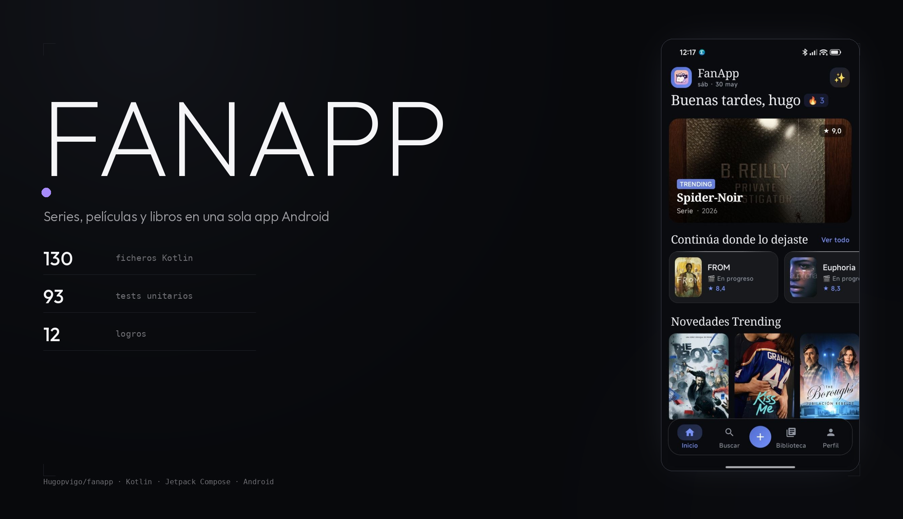
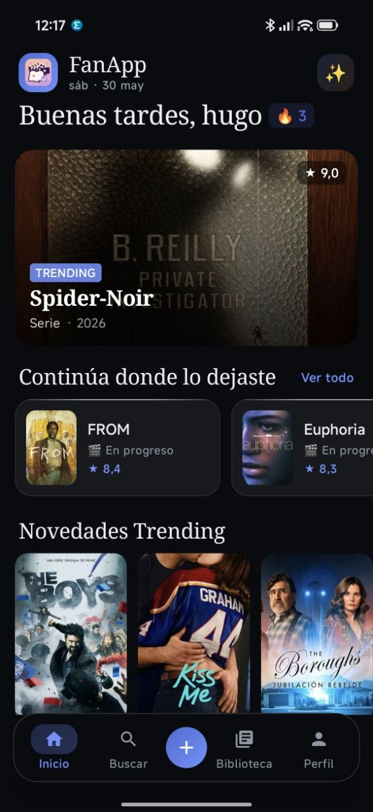
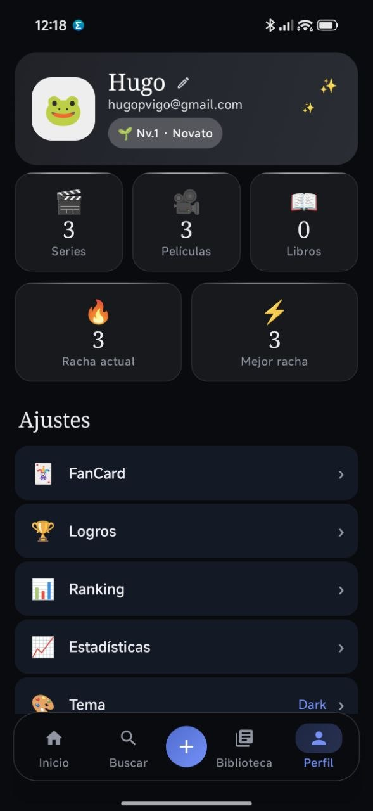
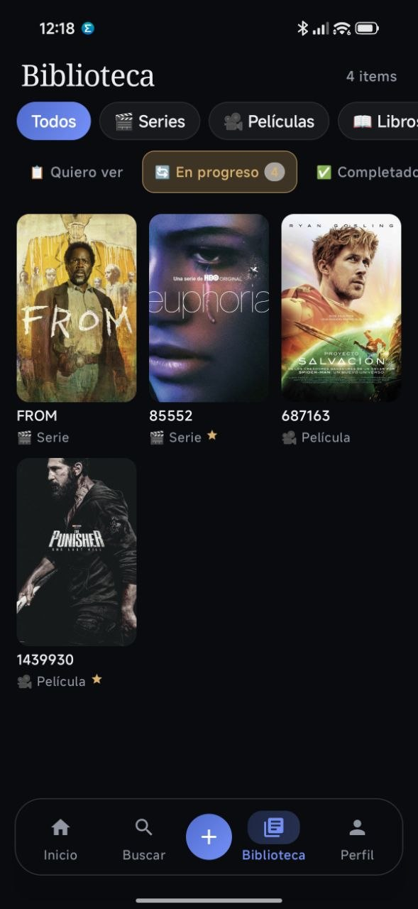
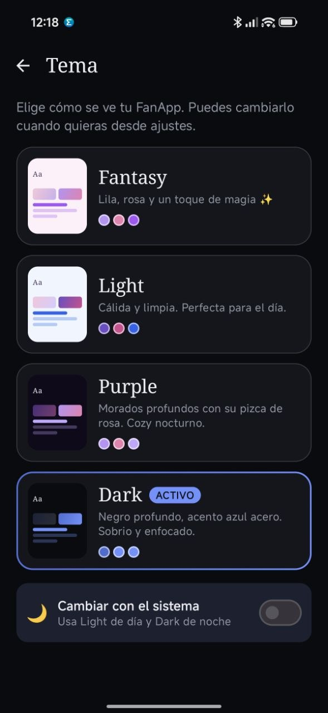

<p align="center">
  
</p>

<p align="center">
  <b>Una app Android para llevar el seguimiento de series, películas y libros en un solo sitio.</b><br>
  Estados, temporadas, páginas, valoraciones, rachas y logros; con búsqueda en TMDB y Google Books.
</p>

<p align="center">
  
  
  
  
  
</p>

---

## Qué es esto

**FanApp MediaTracker** (`com.mediatracker`) es una app Android nativa en
Kotlin que unifica el seguimiento de **series**, **películas** y **libros**:
lo que quieres ver, lo que estás a medias, lo que terminaste y lo que
abandonaste, con detalle de temporada y episodio, página a página, y
valoraciones con notas.

No está en Play Store: es un proyecto en desarrollo abierto en este
repositorio. Todo lo que hay aquí es el código real que compila, con sus
tests.

- **Una sola lista** para los tres tipos de contenido, con filtros por
  estado y por tipo.
- **Búsqueda real** en TMDB (series y películas) y en Google Books / Open
  Library (libros), no una base de datos de ejemplo.
- **Offline-first**: Room guarda todo en local y Firestore sincroniza.
- **Juego dentro**: rachas diarias, XP, 12 logros, estadísticas y ranking.
- **Importación y exportación social**: CSV de Letterboxd y Goodreads, y
  una FanCard compartible con tus datos.

## Pantallas

| | |
|---|---|
|  |  |
| **Inicio**:Continúa donde lo dejaste, novedades y destacados. | **Perfil**: contadores, rachas, logros, estadísticas, ranking, FanCard y ajustes. |
|  |  |
| **Biblioteca**: tus títulos filtrados por estado y por tipo. | **Tema**: cuatro temas y el modo automático día/noche. |

La navegación de abajo tiene cuatro destinos (**Inicio**, **Buscar**,
**Biblioteca**, **Perfil**) y un botón central de **añadir rápido**, que
busca y mete el título en la lista sin pasar por la ficha de detalle.

## Qué hace

| | |
|---|---|
| **Estados** | Quiero ver · En progreso · Completado · Abandonado, y el favorito va aparte. |
| **Series** | Temporada y episodio con auto-avance, barra de progreso y ficha con sinopsis. |
| **Libros** | Páginas leídas y total, paso a paso, con el porcentaje en la tarjeta. |
| **Valoraciones** | Estrellas de 1 a 5 y notas de texto, editables en la ficha. |
| **Añadir rápido** | Hoja inferior con búsqueda en vivo por tipo y estado actual de cada título. |
| **Logros** | 12 logros con desbloqueo automático, progreso visible y aviso en el perfil. |
| **Rachas y XP** | Racha diaria con bonificaciones, nivel y XP acumulados. |
| **Estadísticas** | Gráficos de consumo por tipo y por año (Vico). |
| **Ranking** | Clasificación en Firestore: general, anual y por tipo, con tu posición. |
| **Importar CSV** | Letterboxd y Goodreads: origen → archivo → vista previa → resultado, con deduplicación. |
| **FanCard** | Tarjeta de perfil, top del mes o valoración, exportable como imagen. |
| **Notificaciones** | Firebase Cloud Messaging y avisos locales al desbloquear logros. |
| **Widget** | Glance: lo que estás viendo ahora mismo en la pantalla de inicio. |
| **Idiomas** | Español e inglés. |

## Compilar

Necesitas el SDK de Android (compileSdk 36) y JDK 17.

```bash
git clone https://github.com/Hugopvigo/fanapp.git
cd fanapp
cp local.properties.example local.properties
```

Rellena `local.properties` con tu SDK y tus claves:

```properties
sdk.dir=/ruta/al/android-sdk
TMDB_API_KEY=tu_clave
GOOGLE_BOOKS_API_KEY=tu_clave
FIREBASE_PROJECT_ID=tu_proyecto
```

Añade tu `google-services.json` en `app/` (no se versiona) y compila:

```bash
./gradlew assembleDebug
./gradlew testDebugUnitTest    # 93 tests
```

Sin `google-services.json` la app arranca, pero el registro con Firebase
—y con él el guardado en la nube— no funciona.

## Con qué está hecha

| | |
|---|---|
| Lenguaje | Kotlin 2.3 · Jetpack Compose con Material 3 |
| Arquitectura | Clean Architecture + MVVM, organizada en capas |
| Inyección de dependencias | Hilt |
| Base de datos local | Room (offline-first) |
| Nube | Firebase Auth, Firestore, Messaging, Storage |
| Red | Retrofit + OkHttp + kotlinx.serialization |
| Imágenes | Coil |
| Gráficos | Vico |
| Widget | Glance |
| Navegación | Navigation Compose |

## Estructura

```
fanapp/
├── app/src/main/java/com/mediatracker/
│   ├── data/          APIs, Room, Firestore, repositorios, import CSV
│   ├── domain/        modelos, interfaces y casos de uso
│   ├── presentation/  pantallas, ViewModels, componentes, tema
│   ├── di/            módulos de Hilt
│   ├── service/       receptor de mensajes de Firebase
│   └── core/          utilidades transversales
├── app/src/test/      14 ficheros de tests unitarios
├── docs/              logo y capturas
├── gradle/            catálogo de versiones
└── CHANGELOG.md       detalle por sprint
```

La regla de diseño es que la UI nunca habla directamente con una API ni
con una base de datos: todo pasa por los casos de uso de `domain/`.

## Estado

El proyecto está en desarrollo activo. Lo que ya funciona y está en el
código:

- MVP completo: registro, búsqueda, ficha de detalle, listas, inicio y
  perfil con contadores.
- Fases 2 y 3: añadir rápido, temporadas y episodios, valoraciones y
  notas, progreso de páginas, estadísticas, rachas, 12 logros, ranking,
  importación CSV, FanCard, widget y notificaciones.

Lo que está planificado y **todavía no**: 45 logros en vez de 12, niveles
avanzados con multiplicadores, resumen semanal y sistema de retos. El
detalle por sprint está en [`CHANGELOG.md`](CHANGELOG.md).

## Licencia

**CC BY-NC-SA 4.0** — Creative Commons Atribución-NoComercial-CompartirIgual.
Se puede leer y adaptar el código, con crédito, sin uso comercial y
republicando bajo la misma licencia. El texto completo está en
[`LICENSE`](LICENSE).

Las capturas son de la app en funcionamiento; las portadas de las series y
películas pertenecen a sus respectivos titulares.

---

<p align="center">
  Desarrollado por <a href="https://github.com/Hugopvigo">Hugo Perez-Vigo</a> · <a href="https://x.com/hugopvigo">@hugopvigo</a>
</p>
